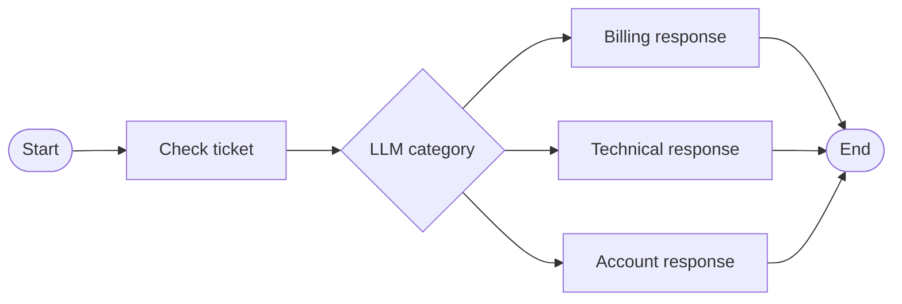
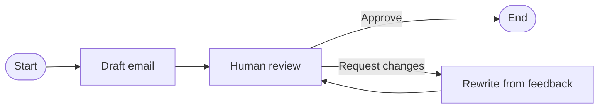

# Day 10 — LangGraph Hands-on

This day's exercises use LangGraph to build two small workflows: route a support ticket to the right team, and draft an email with a human review-and-rewrite loop.

## What you'll learn

- How `StateGraph` keeps data shared between workflow nodes.
- How to define nodes and connect them with regular or conditional edges.
- How an LLM can choose a route between workflow branches.
- How to pause a workflow for human feedback and loop back for revisions.

## Examples

### 1. Support ticket router

`01_Support Ticket Router.py` asks for a ticket, categorizes it as `billing`, `technical`, or `account`, and routes to the matching response node. Each response node ends the graph.



### 2. Email draft with human review

`02_Email_Draft.py` generates an email draft, shows it for approval, and either ends with the approved draft or uses feedback to rewrite it and request another review.



## Requirements

- Python
- A Groq API key
- The `langgraph`, `langchain-groq`, and `python-dotenv` packages

## Setup

Open a terminal in this folder and install the dependencies:

```powershell
python -m venv .venv
.\.venv\Scripts\Activate.ps1
python -m pip install langgraph langchain-groq python-dotenv
```

Create a `.env` file in this folder:

```dotenv
GROQ_API_KEY=your_groq_api_key
```

Keep your API key private. Do not commit or share the `.env` file.

## Run

Run either exercise from this folder:

```powershell
python "01_Support Ticket Router.py"
```

```powershell
python "02_Email_Draft.py"
```

The ticket router asks for a support issue and prints the chosen category and response. The email workflow asks what email to write, then prompts for approval or revision feedback until approved.

## Project files

- `01_Support Ticket Router.py` — LLM-based support-ticket routing graph.
- `02_Email_Draft.py` — email drafting graph with human approval and feedback loop.
