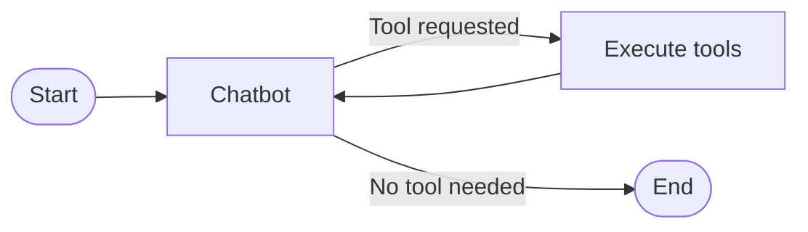
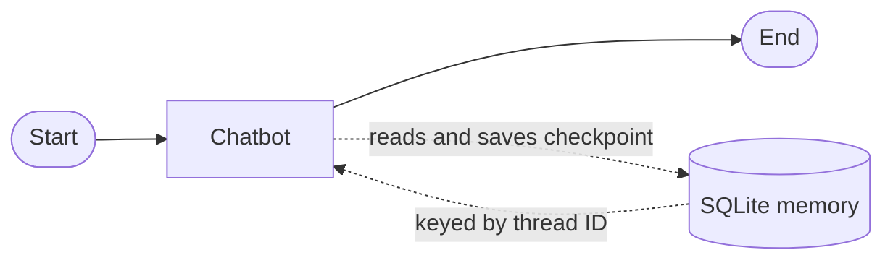

# Day 11 — LangGraph Tool Execution and State

This day's exercises demonstrate two ways to extend a LangGraph assistant: let the model call Python tools, and preserve a conversation across turns with SQLite checkpoints.

## What you'll learn

- How to define Python functions as LangChain tools.
- How a model requests a tool and LangGraph executes it.
- How `MessagesState` carries conversation messages through a graph.
- How a SQLite checkpointer saves conversation state by thread ID.
- How to inspect prior messages and resume a conversation.

## Examples

### 1. Tool-enabled AI assistant

`01_Tool-Enabled_AI_Assistant.py` offers a calculator, a text analyzer, and a local date/time tool. The graph routes to the tools when the model requests them, then returns the tool results to the model.



### 2. Stateful conversational assistant

`02_Stateful_ConversationalAssistant.py` saves messages in a local SQLite database. Each conversation ID is a LangGraph thread; entering the same ID again resumes its saved history. Type `history` to display messages from the active thread.



## Requirements

- Python
- A Groq API key
- Internet access to call the Groq API

## Setup

Open a terminal in this folder and install the dependencies:

```powershell
python -m venv .venv
.\.venv\Scripts\Activate.ps1
python -m pip install langgraph langchain-groq langgraph-checkpoint-sqlite python-dotenv
```

Create a `.env` file in this folder:

```dotenv
GROQ_API_KEY=your_groq_api_key
```

Keep the API key private. Do not commit or share `.env`.

## Run

Run either example from this folder:

```powershell
python "01_Tool-Enabled_AI_Assistant.py"
```

```powershell
python "02_Stateful_ConversationalAssistant.py"
```

The first script accepts requests such as “multiply 12 by 4,” “count the words in this sentence,” or “what time is it?”. Type `exit` to stop.

The second script asks for a conversation ID before starting. Use the same ID to continue that conversation later, or a different ID to start a separate one. Type `history` to inspect saved messages and `exit` to stop. It creates `assistant_memory.db` locally; that database may contain conversation content, so do not publish it.

## Project files

- `01_Tool-Enabled_AI_Assistant.py` — LangGraph assistant with calculator, text-analysis, and date/time tools.
- `02_Stateful_ConversationalAssistant.py` — conversational graph using SQLite-backed checkpoints.
- `.gitignore` — excludes local credentials, Python environment/cache files, and the SQLite conversation database from Git.
- `.env` — local Groq API key; ignored by Git and should remain private.
