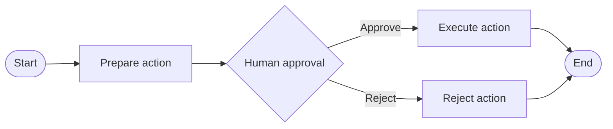
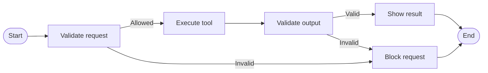

# Day 12 — LangGraph Human-in-the-Loop and Guardrails

This day's exercises demonstrate two ways to make LangGraph workflows safer and more controlled: pause for human approval before an action, and validate tool requests and results before returning them.

## What you'll learn

- How LangGraph interrupts a workflow and resumes it with `Command`.
- How checkpointing preserves a paused workflow by thread ID.
- How to validate tool names, arguments, and outputs before accepting a result.
- How an LLM can select a tool while application code enforces the allowed operations.

## Examples

### 1. Human-in-the-loop approval

`01_HITL.py` prepares an action and pauses at an approval interrupt. The user can approve or reject it; only approval routes to the execution node. The SQLite checkpointer stores workflow state in `approval.db`.



### 2. Guarded tool execution

`02_Guardrails.py` asks the model to select a calculator or text-analysis tool and provide arguments. The graph validates the tool request before execution, checks the output, and blocks unsupported or invalid requests.



## Requirements

- Python
- A Groq API key
- Internet access to call the Groq API

## Setup

Open a terminal in this folder and install the dependencies:

```powershell
python -m venv .venv
.\.venv\Scripts\Activate.ps1
python -m pip install langgraph langgraph-checkpoint-sqlite langchain-groq python-dotenv pydantic ipython
```

Create a `.env` file in this folder:

```dotenv
GROQ_API_KEY=your_groq_api_key
```

Keep the API key private. Do not commit or share `.env`.

## Run

Run either example from this folder:

```powershell
python "01_HITL.py"
```

```powershell
python "02_Guardrails.py"
```

The HITL example asks for an action and a thread ID, then prompts for approval. Enter `yes` to execute or `no` to reject. An unrecognized response leaves the workflow paused in the checkpoint; this script does not provide a separate resume prompt after it exits.

The guardrails example asks what you want done and lets the model select a supported tool. Calculator inputs are limited to the four basic operations and finite numeric values up to one billion in magnitude. Text analysis accepts up to 5,000 characters. Unsupported requests or invalid tool inputs/results are blocked.

The scripts create `approval.db` locally for HITL checkpoints. The database is ignored by Git.

## Project files

- `01_HITL.py` — approval interrupt, resume, and SQLite-backed checkpoint example.
- `02_Guardrails.py` — LLM-selected calculator/text-analysis tools with request and result validation.
- `.gitignore` — excludes credentials, Python environment/cache files, and local SQLite data.
